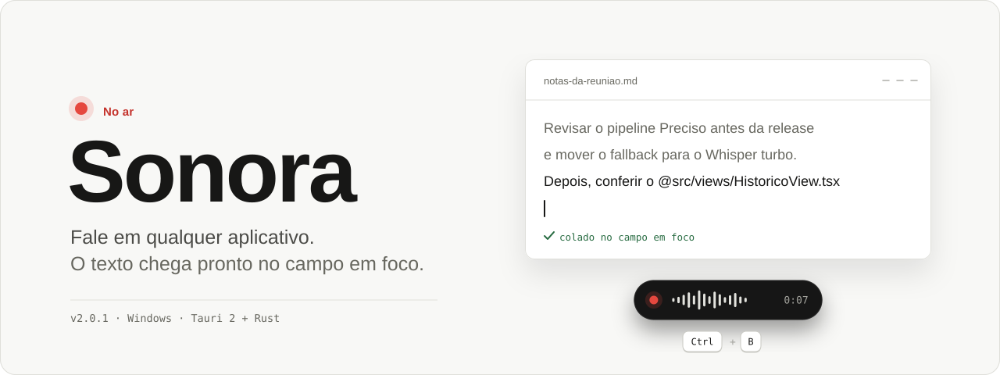
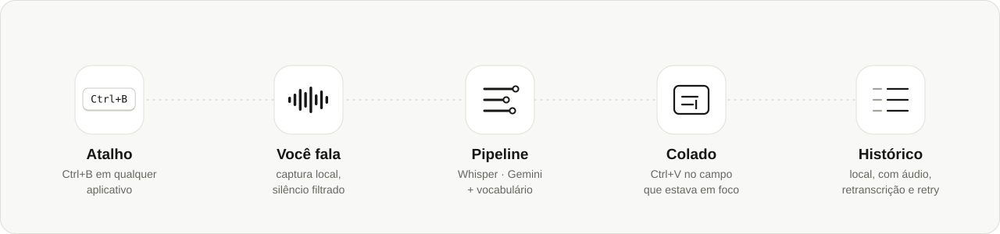

<picture>
  <source media="(prefers-color-scheme: dark)" srcset="docs/assets/hero-dark.svg">
  
</picture>

<p align="center">
  <a href="https://github.com/riique/Sonora/actions/workflows/windows.yml"></a>
  
  
  
</p>

<p align="center">
  <a href="#como-funciona"><b>Como funciona</b></a> &nbsp;·&nbsp;
  <a href="#transcrição">Transcrição</a> &nbsp;·&nbsp;
  <a href="#comece-agora">Comece agora</a> &nbsp;·&nbsp;
  <a href="#arquitetura">Arquitetura</a> &nbsp;·&nbsp;
  <a href="#documentação">Documentação</a>
</p>

<br>

**Sonora** é um aplicativo desktop de **digitação por voz** para Windows. Aperte um atalho global, fale, aperte de novo: o áudio é transcrito por motores em nuvem, opcionalmente refinado, e o texto é colado no campo que estava em foco, em qualquer aplicativo.

A janela principal é o estúdio onde você revisa gravações e ajusta o equipamento. No dia a dia, quem trabalha é o **gadget**: uma pílula preta, sempre no topo, que só acende quando você está no ar.

> *Quiet by default. Information appears when needed.*

<br>

## Como funciona

<picture>
  <source media="(prefers-color-scheme: dark)" srcset="docs/assets/flow-dark.svg">
  
</picture>

| | |
|:--|:--|
| <kbd>Ctrl</kbd> + <kbd>B</kbd> | Inicia e encerra a gravação, de qualquer aplicativo |
| <kbd>Ctrl</kbd> + <kbd>Q</kbd> | Cancela sem gerar texto novo |
| <kbd>Ctrl</kbd> + <kbd>Shift</kbd> + <kbd>B</kbd> | Comando de voz sobre o texto selecionado |

Os atalhos podem ser reconfigurados em **Ajustes › Geral**, onde também dá para escolher entre apertar ou segurar para falar.

<br>

## Novidades desta versão (2.7.0)

- **ElevenLabs Scribe v3 direto:** novo provedor "ElevenLabs (API direta)" com chave própria, usando a API síncrona `/v1/speech-to-text` com `scribe_v3`. O áudio vai como PCM 16 kHz cru (`pcm_s16le_16`), sem marcações de som, sem hesitações, números em dígitos e o vocabulário como `keyterms`.
- **Seletor mais enxuto:** os modelos da OpenAI saíram da lista do OpenRouter, que fica com AssemblyAI Universal-3.6 Pro e ElevenLabs Scribe v2. O Whisper continua como reserva automática.
- **Ditado mais rápido:** a conexão com o provedor é aberta enquanto você grava, e o áudio é salvo em disco em paralelo com o envio.
- **Gravações interrompidas no menu ⋯ do Histórico:** a lista não ocupa mais o topo, ganhou "Dispensar todas" (sem apagar áudio) e gravações canceladas deixam de aparecer como interrompidas.

### Novidades anteriores (2.6.0)

- **AssemblyAI direta (`assemblyai-stt-3-7`):** provedor independente com chave de API própria utilizando a API oficial pré-gravada (`/v2/upload`, `/v2/transcript` com `speech_models`, polling e recuperação), preservando a comparação com **Universal-3.6 Pro** pelo OpenRouter.
- **Pipeline acústico aprimorado:** normalização dinâmica conservadora em duas passagens com preservação do áudio original quando já está bem nivelado, proteção de vozes baixas/altas e mudanças bruscas de volume sem distorção, pré-buffer de 500 ms e preservação de pausas longas sem encerrar a captura nem gerar alucinações no silêncio.
- **OpenRouter mais flexível e catálogo limpo:** remoção completa do Google AI Studio e de modelos Gemini do catálogo; suporte para inserir e salvar qualquer ID customizado compatível do OpenRouter.
- **Simplificação e qualidade:** remoção completa do Contexto Inteligente mantendo o vocabulário personalizado, otimização de prompts/keyterms da AssemblyAI e novos testes comparativos de precisão.

### Novidades anteriores (2.5.0)

**Mais simples.** O Sonora agora faz uma coisa só e bem feita: você fala, ele transcreve e cola o texto no campo em foco.

- **Um modo só:** “Rápido e preciso”. Em **Ajustes › Transcrição** você escolhe o provedor (OpenRouter ou Google AI Studio) e o modelo: AssemblyAI Universal-3.6 Pro, Gemini 3.5 Transcribe, Gemini 3.5 Flash-Lite ou Gemini 3.6 Flash. Se o modelo falhar, o Whisper entra sozinho como reserva e o Histórico marca isso.
- **AssemblyAI sem ID customizado:** agora é uma opção fixa da lista. Quem usava `assemblyai/universal-3-6-pro` como ID customizado é migrado sozinho; o contexto inteligente continua aparecendo quando ele está selecionado.
- **Ajustes em três abas:** Geral, Transcrição (modelo e chaves) e Vocabulário.
- **Continuam:** comando de voz (`Ctrl+Shift+B`), vocabulário com sugestões das suas correções, Histórico, Insights e o retrato da sua voz.
- **Gravações interrompidas** aparecem no topo do Histórico para retranscrever, só quando existem.
- **Removido:** os modos Ultrarrápido, Preciso e Ultrapreciso, IDs de modelo customizados, provedor Meta, o validador semântico, o refinamento rápido, snippets, styles por aplicativo, captura de texto da tela e a extensão de navegador, FileTagging, níveis de formatação, notas, transcrição offline, backup, itens removidos e modo desenvolvedor.

### Novidades anteriores (2.4.0)

- **Contexto inteligente opcional:** uma imagem da janela ativa e as últimas 5 ou 10 transcrições ajudam um modelo visual da OpenRouter a identificar o assunto e termos relevantes, com controle de ativação e modelo.
- **AssemblyAI Universal-3.6 Pro:** suporte a vocabulário personalizado, contexto conversacional e prompt de domínio no endpoint OpenRouter de transcrição.
- **Idiomas automáticos:** reconhecimento sem português fixado para a AssemblyAI, incluindo alternância entre português e inglês na mesma frase.
- **Segurança e estabilidade:** análise paralela ao ditado, sem persistência das capturas, fallback em erros e atualização das dependências apontadas pelas auditorias.

### Publicar uma versão (atualização automática)

1. Uma única vez: em *Settings › Secrets and variables › Actions* do repositório, crie `TAURI_SIGNING_PRIVATE_KEY` (conteúdo da chave privada do updater) e `TAURI_SIGNING_PRIVATE_KEY_PASSWORD`. A chave pública correspondente está em `src-tauri/tauri.conf.json`.
2. Suba a versão em `package.json`, `package-lock.json`, `src-tauri/tauri.conf.json`, `src-tauri/Cargo.toml` e no topo deste README.
3. Abra um PR da branch de lançamento para a `master`. Quando o arquivo `src-tauri/tauri.conf.json` muda na `master`, o workflow **Release** cria a tag e publica os instaladores assinados automaticamente. O disparo manual e o disparo por tag também continuam disponíveis.

O workflow **Release** gera o instalador assinado e o `latest.json`; as instalações existentes encontram a versão nova sozinhas.

<br>

## Novo na versão 2.0

**Sua voz, mais simples.** Um retrato curto, suas expressões e hábitos de fala, com medições e configurações nos detalhes. O botão do retrato fica à vista com a quantidade de palavras que falta e é habilitado quando você pode gerar uma nova versão.

**Silêncio tratado no computador.** Uma gravação claramente sem voz mostra “Nenhuma voz encontrada” na barra e encerra sem enviar áudio nem colar texto. Falas curtas e baixas são preservadas por uma verificação conservadora.

**Troca de aplicativo.** O ditado usa o campo em foco ao parar, com identificação estável entre a gravação e a entrega, e orienta em português quando o campo muda depois.

**Nova identidade.** Sonora na interface, no executável e nos instaladores. Seus dados e perfis existentes continuam disponíveis.

→ [Mudanças, compatibilidade e atualização da instalação anterior](docs/SONORA_2.0.md)

<br>

## Transcrição

Cada ditado vai para um modelo de transcrição, escolhido em **Ajustes › Transcrição**:

| Modelo | Pelo OpenRouter | Pelo Google AI Studio |
|:--|:--|:--|
| AssemblyAI Universal-3.6 Pro | `assemblyai/universal-3-6-pro` | — |
| Gemini 3.5 Transcribe | `google/gemini-3.5-transcribe` | `gemini-3.5-transcribe` |
| Gemini 3.5 Flash-Lite | `google/gemini-3.5-flash-lite` | `gemini-3.5-flash-lite` |
| Gemini 3.6 Flash | `google/gemini-3.6-flash` | `gemini-3.6-flash` |

Se o modelo falhar, responder vazio ou estiver sem chave, o áudio vai para o `whisper-large-v3-turbo` pelo OpenRouter (Groq fixo). O vocabulário entra no prompt do modelo (ou como `keyterms_prompt` na AssemblyAI) e como dica para o Whisper. Com a AssemblyAI, o [contexto inteligente](docs/ASSEMBLYAI_SMART_CONTEXT.md) opcional também pode ajudar.

**Prompt universal.** Os modelos recebem uma única `systemInstruction` que trata, trecho a trecho, conversa comum, programação e conteúdo acadêmico. Não é preciso escolher um tipo de conteúdo antes de falar.

<br>

## O que vem junto

<table>
<tr>
<td width="50%" valign="top">

**Captura**

- Microfone por atalho global ou pelo botão na interface
- Normalização sensível a ruído: ganho adaptativo limitado, pausas sem amplificar o ruído de sala, limiter em −3 dBFS e original preservado como `.original.wav`
- Captura incremental com limite de 15 minutos e recuperação de áudio interrompido
- Upload de arquivos de áudio (WAV, MP3 e outros)

</td>
<td width="50%" valign="top">

**Entrega**

- Cola automática no campo focado (clipboard + paste simulado)
- Verificação do campo de destino antes do paste
- Se a entrega falhar, o resultado continua no Histórico
- No gadget, uma falha oferece **Regenerar** com o áudio já salvo, sem abrir o Histórico

</td>
</tr>
<tr>
<td width="50%" valign="top">

**Histórico**

- Local, sem limite artificial, paginado e incremental
- Modo, modelos, estágios, textos intermediários, fallback e latências de cada ditado
- Copiar, editar, excluir, retranscrever e avaliar a pronúncia
- Áudio revelável no Explorer

</td>
<td width="50%" valign="top">

**Vocabulário e controle**

- Vocabulário estruturado: grafia canônica, aliases, categoria e literais *strict*
- Telemetria apenas local: latência por estágio, RTF estimado e throughput
- Sugestões de vocabulário a partir das suas correções
- Comando de voz sobre o texto selecionado

</td>
</tr>
</table>

<br>

## Comece agora

### Requisitos

- **Node.js 24** com npm
- **Rust 1.97.1** via [rustup](https://rustup.rs/)
- Chaves de API:

| Provedor | Usado em |
|:--|:--|
| **OpenRouter** | Transcrição pelo OpenRouter, Whisper de reserva, comando de voz e retrato da voz |
| **Google Gemini** | Transcrição pelo Google AI Studio, comando de voz e avaliação de pronúncia |

### Desenvolvimento

```bash
npm install
npm run tauri dev     # app completo
npm run dev           # só a interface, sem o backend nativo
```

### Build de produção

```bash
npm run tauri build
```

<details>
<summary>O <code>cargo</code> não está no <code>PATH</code> (Windows / PowerShell)?</summary>

```powershell
$env:PATH = "$env:USERPROFILE\.cargo\bin;" + $env:PATH
npm run tauri build
```

</details>

| Artefato | Caminho |
|:--|:--|
| Executável | `src-tauri/target/release/sonora.exe` |
| Instaladores | `src-tauri/target/release/bundle/nsis/` e `bundle/msi/` |

Detalhes em [`BUILD.md`](BUILD.md).

### Primeiro ditado

1. Abra **Ajustes › Transcrição** e salve a chave do OpenRouter (e a do Google, se for usar o AI Studio).
2. Escolha o provedor e o modelo.
3. Clique no campo de texto onde o texto deve chegar e aperte <kbd>Ctrl</kbd> + <kbd>B</kbd>.
4. Fale. Aperte <kbd>Ctrl</kbd> + <kbd>B</kbd> de novo para parar: o texto é colado no campo e entra no **Histórico**.
5. Mudou de ideia? <kbd>Ctrl</kbd> + <kbd>Q</kbd> cancela sem gerar texto.

> [!NOTE]
> A gravação pelo microfone **cola** no campo focado; o upload de arquivo **não** cola automaticamente. Arquivos de áudio acima de ~50 MB são rejeitados.

<br>

## Seus dados

Tudo fica no seu computador, em `%APPDATA%\com.haumeavoice.app\`: histórico, configurações, chaves e áudios.

- As chaves de API são protegidas pelo **DPAPI** da sua conta Windows; a interface recebe apenas referências opacas.
- Escritas são atômicas; uma gravação interrompida continua disponível para retranscrever no Histórico.
- Não há analytics externo.

O identificador interno de dados mantém o nome legado para preservar sua instalação. Para migrar para a pasta Sonora com backup e verificação, siga [o procedimento Windows](docs/SONORA_2.0.md#instalação-windows).

<br>

## Arquitetura

```text
src-tauri/src/
├── audio.rs                 captura do microfone, WAV, clipboard e paste
├── transcription/           modo de produto, Whisper de reserva e telemetria
├── gemini/                  Files API, STT e pronúncia
├── openrouter.rs            STT e Chat Completions com áudio
├── pipeline_contract.rs     TranscriptionMode e rota de transcrição
├── vocabulary.rs            termos estruturados
├── assist.rs                comando de voz
├── maintenance.rs           recuperação de gravações interrompidas
└── history.rs · settings.rs

src/views/
├── InicioView.tsx           status, atalhos e últimos ditados
├── HistoricoView.tsx        lista, detalhes, ações e gravações interrompidas
├── InsightsView.tsx         uso e retrato da voz
├── ConfiguracoesView.tsx    Geral, Transcrição e Vocabulário
└── TranscricaoView.tsx      upload de arquivo
```

| Tela | Para quê |
|:--|:--|
| **Início** | Status, atalhos e últimos ditados |
| **Histórico** | Ditados, upload de arquivo, retranscrição e pronúncia |
| **Insights** | Estatísticas de uso e retrato da voz |
| **Ajustes** | Geral, Transcrição e Vocabulário |
| **Gadget** | Pílula compacta, sempre no topo |

<br>

## Testes

```bash
cd src-tauri && cargo test
```

O CI no Windows roda lint, testes de frontend e de UI, build, `cargo fmt`, `clippy` e `cargo test` a cada push. Para a verificação manual, use o [checklist](docs/MANUAL_TEST_CHECKLIST.md).

<details>
<summary><b>Correções da auditoria 1.0.34</b></summary>

<br>

- Chaves protegidas por DPAPI da conta Windows; somente referências opacas chegam à interface.
- Escritas atômicas, histórico incremental paginado e recuperação de itens removidos.
- Captura incremental com limite de 15 minutos, recuperação de áudio interrompido e cancelamento do processamento de ditados.
- Coleta de contexto do navegador somente por solicitação vigente, conforme as fontes habilitadas.
- Verificação do campo de destino antes do paste; resultado e falha de entrega permanecem disponíveis no Histórico.
- Diagnóstico local, backup com áudio opcional, arquivamento e seleção rápida de destino e Style.
- Dependências corrigidas, permissões separadas por janela e CI Windows com verificações de contratos.

Qualificação e limites em [auditoria implementada](docs/audit-remediation.md).

</details>

<br>

## Documentação

| | |
|:--|:--|
| [Sonora 2.0](docs/SONORA_2.0.md) | Mudanças, compatibilidade e migração da instalação |
| [Build](BUILD.md) | Gerar executável e instaladores |
| [Recuperação e release](docs/recovery-and-release.md) | Procedimentos de dados e distribuição |
| [Auditoria implementada](docs/audit-remediation.md) | Qualificação e limites da auditoria |
| [Migração da transcrição](docs/TRANSCRIPTION_MIGRATION_FINAL_REPORT.md) | Relatório técnico dos pipelines |
| [Checklist manual](docs/MANUAL_TEST_CHECKLIST.md) | Roteiro de verificação |
| [Design](DESIGN.md) | O sistema visual “Estúdio no ar” |

<br>

## Licença

Consulte o repositório para a licença aplicável. Chaves de API e dados de uso são de responsabilidade de quem usa o app.

<br>

<p align="center">
  <sub>Feito para quem prefere falar a digitar.</sub>
</p>
